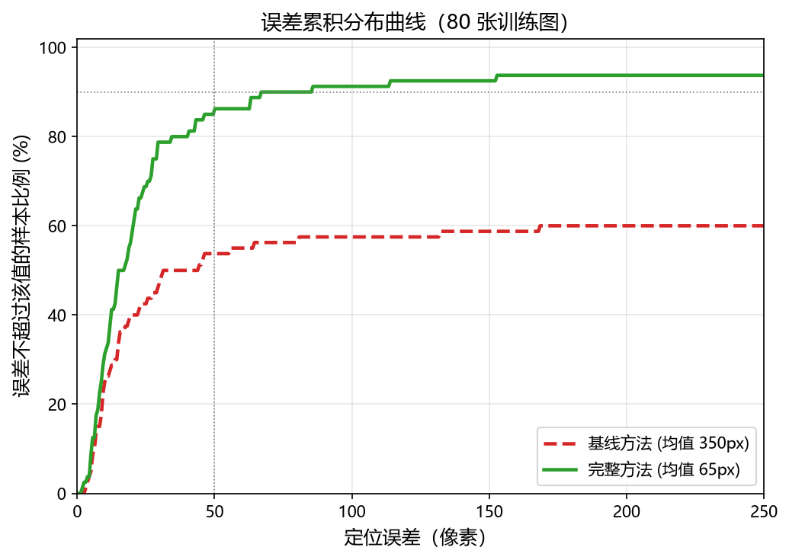
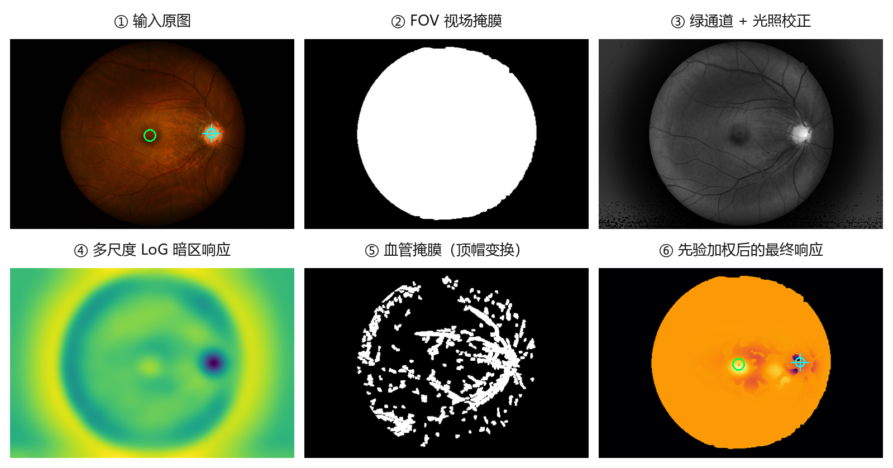
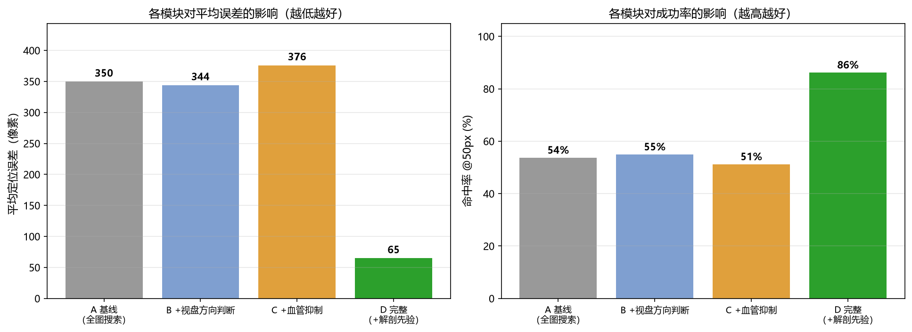
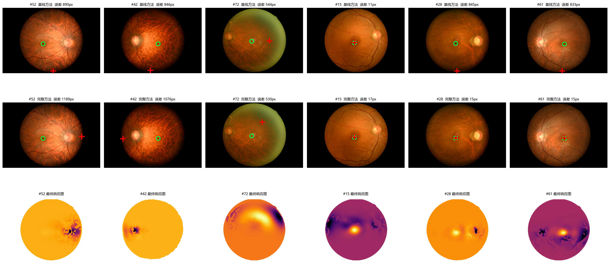

# 眼底图像黄斑中心凹（Fovea）自动定位

> 图像处理课程大作业 · 传统图像处理方法实现（不依赖深度学习）

给定一张彩色眼底照片，自动定位黄斑中心凹（fovea）的像素坐标。
仅使用色彩空间变换、形态学运算、滤波与几何先验等经典图像处理手段。

## 结果

在 80 张训练图上的定量结果：

| 指标 | 基线方法 | 完整方法 | 变化 |
|---|---|---|---|
| 平均误差 | 349.7 px | **64.9 px** | −81.4% |
| 中位误差 | 37.9 px | **16.1 px** | −57.4% |
| 90 分位误差 | 897.7 px | **68.6 px** | −92.4% |
| 成功率 @50 px | 53.8% | **86.2%** | +32.5 pp |
| 成功率 @100 px | 57.5% | **91.2%** | +33.8 pp |
| 单张耗时 | 0.23 s | 0.38 s | — |



## 方法

核心思路：**不直接在全图寻找暗斑，而是先用视盘作为解剖学参照压缩搜索范围。**

黄斑本身对比度极低、边界模糊，且血管交叉点的暗响应往往比它更强。
但视盘亮度高、颜色偏白，极易检测；而二者之间存在稳定的解剖学关系。

对训练集统计可得：以视盘中心为原点、视盘半径为尺度，
黄斑垂直偏移仅 **0.38 r**（90 分位 < 0.8 r），水平距离约 **2.3 r**，
且始终位于视盘的一侧。



### 处理流程

```
输入眼底图
   │
   ├─► 预处理 ── FOV 掩膜（阈值+形态学+最大连通域）
   │            绿通道光照不均校正（高斯背景估计 + 除法校正）
   │
   ├─► 视盘定位 ── 亮度-饱和度联合响应
   │              + DoG 盘状结构增强
   │              + 视场内缩权重（压制圆周拍摄伪影）
   │
   ├─► 解剖学先验 ── 各向异性高斯加权（水平宽松、垂直严格）
   │
   ├─► 黄斑检测 ── 多尺度 LoG 暗区响应
   │              + 血管掩膜抑制（顶帽变换）
   │              + 暗度加权质心亚像素精化
   │
   └─► 输出坐标 (x, y)
```

### 消融实验

| 配置 | 平均误差 | 成功率@50px |
|---|---|---|
| A 基线（全图搜索） | 349.7 px | 53.8% |
| B +视盘方向判断 | 343.9 px | 55.0% |
| C +血管抑制 | 376.0 px | 51.2% |
| **D 完整（+解剖先验）** | **64.9 px** | **86.2%** |



两个反直觉的结论：

- **解剖学先验是唯一起决定作用的模块。** 仅加入视盘方向判断（B）几乎无改善，
  但加入空间先验加权（D）后误差骤降 82.7%。约束搜索范围比提高检测精度重要得多。
- **血管抑制单独使用时是有害的。** B→C 使误差上升 9.3%，因为抑制血管会在密集区
  制造新的假极值。只有在先验压缩搜索范围之后，它才真正开始贡献精度。

### 定性对比



上行基线方法、中行完整方法、下行为最终响应图（绿圈真值，红十字预测）。

## 数据

| 项目 | 说明 |
|---|---|
| 训练集 | 80 张彩色眼底照片 + `fovea_localization_train_GT.csv` 标注 |
| 测试集 | 20 张彩色眼底照片 |
| 图像尺寸 | 1956×1934 ~ 2992×2000（不固定） |
| 标注格式 | `Fovea_X`, `Fovea_Y`，单位原图像素坐标 |

数据集体积较大，未纳入版本管理。按下列结构放入 `data/` 即可复现：

```
data/detection/
├── train/                          0001.jpg ~ 0080.jpg
├── test/                           0081.jpg ~ 0100.jpg
├── train_location/                 标注 XML
├── fovea_localization_train_GT.csv
└── sample_submission.csv
```

## 快速开始

```bash
pip install -r requirements.txt

# 训练集评估（基线 vs 完整方法）
python scripts/evaluate.py

# 消融实验
python scripts/ablation.py

# 生成测试集提交文件
python scripts/predict.py --out submission.csv

# 重新生成报告图表
python scripts/make_figures.py
python scripts/make_fig1.py
```

## 目录结构

```
fovea_lab/
├── preprocess.py   FOV 掩膜、光照校正、CLAHE、血管掩膜、视场内缩权重
├── disc.py         视盘定位（亮度-饱和度 + DoG + 边缘抑制）
├── macula.py       黄斑检测（多尺度 LoG + 血管抑制 + 解剖先验）
├── pipeline.py     完整流程封装
└── evaluate.py     评估指标（欧氏误差、命中率、CDF）
scripts/
├── evaluate.py     基线 vs 完整方法对比
├── ablation.py     消融实验
├── predict.py      生成提交文件
├── make_figures.py 报告图表
└── build_report.py 生成报告 docx
```

## 环境

Python 3.10+，依赖见 `requirements.txt`：
numpy、scipy、pandas、Pillow、matplotlib、opencv-python。

## 参考

1. Zhu, X., Rangayyan, R. M., & Ells, A. L. (2010). Detection of the optic disc
   in fundus images of the human retina. *Journal of Biomedical Informatics*.
2. Tobin, K. W., et al. (2007). Detection of anatomic structures in human retinal
   imagery. *IEEE Transactions on Medical Imaging*.
3. 冈萨雷斯《数字图像处理》（第四版），第 3 章灰度变换、第 9 章形态学。

## License

MIT
